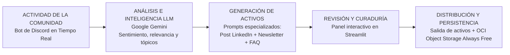

# G10-LATAM-EQUIPO43-CommunityLab

## 📌 Descripción del proyecto
Motor inteligente que transforma la actividad orgánica de una comunidad digital (mensajes, dudas, testimonios en Discord) en activos de marketing listos para publicar, utilizando IA generativa multimodal y automatización de flujos con curaduría humana (*Human-in-the-Loop*). Proyecto oficial del Hackathon ONE G10 (Oracle Next Education & Alura).

---

## 🚀 Despliegue en Vivo y Entregables

- **🎥 Video Demostración (YouTube):**  
  👉 [Ver Video Demo en YouTube (4:48 min)](https://youtu.be/t2MH_sulCiY?si=zJZUWs0LZVNBmf9G)

- **🖥️ Panel de Curaduría (Frontend en Streamlit Cloud):**  
  👉 [https://communitylab-g43.streamlit.app](https://communitylab-g43.streamlit.app)  
  *(Interfaz interactiva para revisión, edición y aprobación de copys en tiempo real).*

- **⚙️ Orquestación de Flujos (n8n en OCI Compute VM):**  
  👉 [https://163-176-170-76.sslip.io](https://163-176-170-76.sslip.io)  
  *(Instancia Canonical Ubuntu 22.04 Always Free en Oracle Cloud - Brazil East).*

- **🪣 Persistencia en la Nube (Always Free):**  
  👉 **OCI Object Storage:** Bucket `communitylab-activos-marketing` (Namespace `grhxfjzkgrnw`, Región `sa-saopaulo-1`).

---

## 🏆 Estado actual
**Sprint 5/5 — MVP Funcional End-to-End Completado.**  
Pipeline de ingesta en tiempo real desde Discord, análisis semántico con Google Gemini (cálculo de sentimiento, tópicos y scores de relevancia), bifurcación hacia activos (LinkedIn, Newsletter, FAQ), panel web de curaduría y persistencia histórica en frío en Oracle Cloud.

---

## 🏗️ Arquitectura del Pipeline



---


## 🛠️ Stack Tecnológico
- **Modelos de Lenguaje (LLM):** Google Gemini 1.5 / 2.0 Flash (vía Google AI Studio API).
- **Orquestación:** n8n (self-hosted en VM Linux Always Free de OCI con SSL).
- **Base de Datos Operativa:** PostgreSQL en Supabase (Pooler IPv4 con SSL).
- **Almacenamiento en la Nube:** OCI Object Storage (Bucket Always Free).
- **Frontend / UI:** Streamlit (desplegado en Streamlit Community Cloud).
- **Ingesta:** Discord Bot en Python (`discord.py`).
- **Control de Versiones:** Git Flow en GitHub con Pull Requests y ramas de features.

---

## 📂 Estructura del repositorio
```text
G10-LATAM-EQUIPO43-CommunityLab/
├── backend/
│   ├── bot discord n8n/        # Bot de Discord en Python
│   └── workflows/              # Workflows exportados en JSON para n8n
├── frontend/
│   ├── app.py                  # Panel interactivo de curaduría en Streamlit
│   └── requirements.txt        # Dependencias de Python
├── data/                       # Datasets de prueba e interacciones simuladas
├── database/                   # Scripts de migración y esquemas SQL
├── docs/                       # Documentación técnica, contratos y guías de prompts
└── README.md
```
