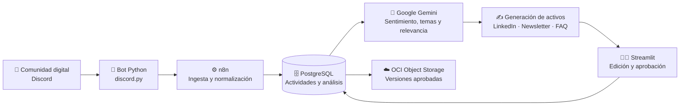

<div align="center">

# 🌐 CommunityLab
### Inteligencia artificial para transformar comunidades digitales en activos de contenido

**G10-LATAM · Equipo 43 · Hackathon ONE G10 — Oracle Next Education & Alura**

<p>
  <a href="https://youtu.be/t2MH_sulCiY?si=zJZUWs0LZVNBmf9G">
    
  </a>
  <a href="https://communitylab-g43.streamlit.app">
    
  </a>
  <a href="https://163-176-170-76.sslip.io">
    
  </a>
</p>

</div>

---

## 📌 Sobre el proyecto

**CommunityLab** es un sistema que transforma la actividad orgánica de una comunidad digital —mensajes, dudas, comentarios y testimonios en Discord— en activos de contenido orientados a marketing y educación.

Combina **inteligencia artificial generativa**, automatización de procesos y curaduría humana (*Human-in-the-Loop*) para analizar las conversaciones, detectar temas y oportunidades, generar contenido y someterlo a revisión antes de su uso.

El objetivo es convertir las señales de una comunidad en contenido útil sin perder el contexto de las interacciones originales ni delegar la aprobación final exclusivamente a la IA.

## 🚀 Demo y despliegue

| Recurso | Descripción |
|---|---|
| 🎥 [Video de demostración](https://youtu.be/t2MH_sulCiY?si=zJZUWs0LZVNBmf9G) | Demostración del MVP en YouTube (4:48 min). |
| 🖥️ [Panel de curaduría](https://communitylab-g43.streamlit.app) | Aplicación Streamlit para revisar, editar y aprobar activos. |
| ⚙️ [Instancia de n8n](https://163-176-170-76.sslip.io) | Interfaz de orquestación de workflows desplegada en una VM de OCI. Requiere la configuración de acceso correspondiente. |
| 🪣 OCI Object Storage | Persistencia de activos y versiones en el bucket `communitylab-activos-marketing`, región `sa-saopaulo-1`. |

> **Estado del proyecto:** Sprint 5/5 — MVP funcional *end-to-end* completado, según el estado reportado por el equipo.

## ✨ Funcionalidades principales

- **Ingesta en tiempo real:** un bot de Discord escucha los canales configurados y envía mensajes a n8n.
- **Análisis semántico con IA:** clasificación de sentimiento, temas, relevancia e insights de las interacciones.
- **Generación de activos:** creación asistida de publicaciones para LinkedIn, contenido para newsletters y FAQ o tips técnicos.
- **Curaduría humana:** revisión, edición y aprobación de los activos desde un panel en Streamlit.
- **Persistencia de versiones aprobadas:** almacenamiento de activos en OCI Object Storage, con seguimiento del estado de persistencia en PostgreSQL.

## 🏗️ Arquitectura del sistema



### Flujo de trabajo

1. **Captura:** el bot de Discord recibe mensajes de los canales permitidos.
2. **Ingesta:** n8n valida y normaliza el contenido y lo registra en PostgreSQL.
3. **Análisis:** el modelo de lenguaje identifica sentimiento, temas, relevancia e insights.
4. **Generación:** según el análisis, se preparan los activos de contenido correspondientes.
5. **Curaduría:** una persona revisa, edita y aprueba o rechaza los activos desde Streamlit.
6. **Persistencia:** el workflow de OCI almacena las versiones aprobadas y registra el resultado del proceso.

La generación de un activo no implica su publicación automática en LinkedIn: el flujo contempla una etapa de revisión humana.

## 🧰 Stack tecnológico

<div align="center">

[](https://www.python.org/)
[](https://discord.com/)
[](https://n8n.io/)
[](https://ai.google.dev/)
[](https://www.postgresql.org/)
[](https://streamlit.io/)
[](https://www.oracle.com/cloud/)
[](https://github.com/)

</div>

| Componente | Tecnología | Uso en el proyecto |
|---|---|---|
| Ingesta | Python, `discord.py`, `requests` | Escucha de mensajes y envío de payloads al webhook. |
| Automatización | n8n | Orquestación de ingesta, procesamiento, generación y persistencia. |
| IA generativa | Google Gemini mediante Google AI Studio API | Análisis de interacciones y generación de contenido. |
| Base de datos | PostgreSQL en Supabase | Persistencia de actividades, análisis, activos y estados. |
| Interfaz web | Streamlit | Curaduría humana de los activos generados. |
| Almacenamiento | Oracle Cloud Infrastructure (OCI) Object Storage | Conservación de versiones aprobadas. |
| Control de versiones | Git y GitHub | Colaboración, ramas de trabajo y Pull Requests. |

## 📂 Estructura del repositorio

```text
G10-LATAM-EQUIPO43-CommunityLab/
├── backend/
│   ├── bot discord n8n/
│   │   ├── bot.py
│   │   ├── requirements.txt
│   │   └── .env.example        # Plantilla, si está incluida en el repositorio
│   ├── workflows/              # Workflows exportados de n8n en JSON
│   └── README.md
├── frontend/
│   ├── app.py                  # Panel de curaduría en Streamlit
│   ├── requirements.txt
│   └── README.md
├── data/                       # Datasets de prueba y ejemplos JSON
├── database/                   # Esquemas y scripts SQL
├── docs/                       # Diagramas, contratos y guías técnicas
└── README.md
```

La documentación específica de cada componente se encuentra en los README de sus respectivas carpetas.

## ⚡ Puesta en marcha

CommunityLab depende de servicios externos (Discord, n8n, PostgreSQL, el proveedor de IA y OCI). Para ejecutar el flujo completo, es necesario configurar las credenciales y conexiones correspondientes.

1. **Configuración de Discord:** se debe crear una aplicación y un bot en el [Discord Developer Portal](https://discord.com/developers/applications), invitarlo al servidor, habilitar `Message Content Intent` y definir los canales que podrá escuchar.
2. **Configuración del bot:** se deben instalar las dependencias desde `backend/bot discord n8n/requirements.txt` y definir las variables de entorno necesarias, incluido `DISCORD_TOKEN` y el webhook de n8n.
3. **Configuración de n8n:** se deben importar los archivos JSON de `backend/workflows/` y establecer las credenciales de PostgreSQL, del proveedor LLM y de OCI.
4. **Preparación de la base de datos:** se deben aplicar los esquemas y scripts documentados en `database/`.
5. **Ejecución del bot:** se debe iniciar `bot.py` y mantenerlo en ejecución para que la ingesta de mensajes de Discord funcione en tiempo real.
6. **Acceso al frontend:** se puede utilizar el [panel de curaduría](https://communitylab-g43.streamlit.app) para revisar los activos generados.

Los comandos detallados, las variables de entorno y las particularidades de cada componente se documentan en `backend/README.md` y `frontend/README.md`.

## 🔐 Seguridad

- Se recomienda no subir tokens, claves API, contraseñas ni archivos `.env` al repositorio.
- Se recomienda mantener los secretos en variables de entorno y configurar adecuadamente `.gitignore`.
- Se recomienda limitar los permisos del bot de Discord a los canales necesarios.
- Se recomienda proteger los webhooks y la interfaz de administración de n8n.
- Se recomienda revisar los permisos de acceso a PostgreSQL y al bucket de OCI antes del despliegue.

## 👥 Equipo

**G10-LATAM · Equipo 43**  
Proyecto desarrollado para el Hackathon ONE G10, iniciativa de Oracle Next Education y Alura.

---

<div align="center">

**CommunityLab — De conversaciones reales a contenido con propósito.**

</div>
